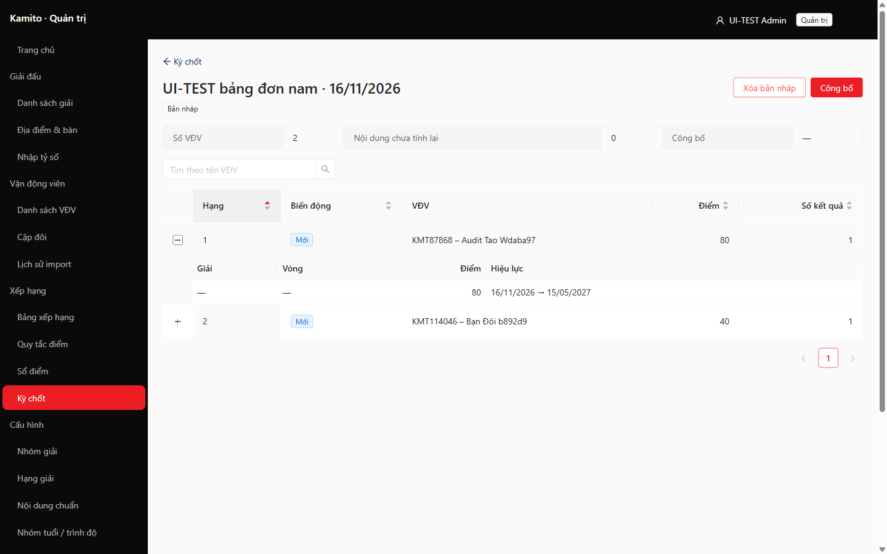
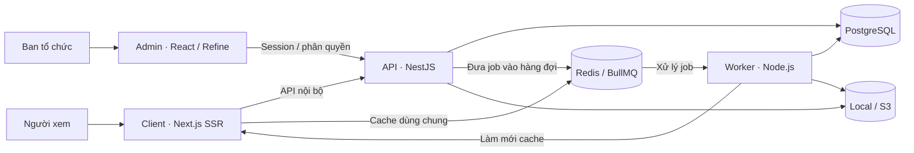

# WTT · Kamito

<div align="center">

**Từ đăng ký thi đấu đến kỳ chốt xếp hạng.**

Nền tảng quản lý giải bóng bàn, điều hành trận đấu và công bố thông tin giải.

[](https://github.com/nhonhoatran/wtt/actions/workflows/ci.yml)


[Tính năng](#tính-năng) · [Bắt đầu](#chạy-local) · [Kiến trúc](#kiến-trúc) · [Tài liệu](#tài-liệu) · [Đóng góp](#đóng-góp)

</div>

WTT tập trung công việc của ban tổ chức vào một hệ thống: quản lý vận động viên, nhận danh sách đăng ký, bốc thăm, xếp lịch, nhập kết quả và tính điểm xếp hạng. Người xem theo dõi giải, bảng xếp hạng và hồ sơ vận động viên qua website công khai.

**Trạng thái:** đang phát triển, đã triển khai mã nguồn đến trang xếp hạng và hồ sơ vận động viên công khai của phase 10. Staging và production chưa được triển khai; kết quả kiểm chứng và phần còn mở nằm trong [lộ trình](docs/development-roadmap.md).

## Tính năng

| Phạm vi | Đã có trong mã nguồn |
|---|---|
| **Tổ chức giải** | Giải đấu, nội dung thi đấu, địa điểm, bàn, danh mục và cấu hình nghiệp vụ |
| **Vận động viên** | Hồ sơ quản trị, cặp đôi, đăng ký thi đấu, nhập và xuất Excel, gộp hồ sơ |
| **Bốc thăm** | Loại trực tiếp, vòng loại, chia bảng, hạt giống, BYE và xếp hạng vòng bảng |
| **Điều hành** | Nhập, chốt, sửa và mở lại tỷ số; lịch theo phiên và bàn; in phiếu trận, xuất lịch và kết quả |
| **Xếp hạng** | Ma trận quy tắc có phiên bản, sổ điểm, điểm thủ công, dựng và công bố kỳ chốt, gợi ý hạt giống |
| **Website công khai** | Danh sách và lịch giải, nhánh và kết quả, lịch bàn và bản in, bảng xếp hạng với chi tiết điểm của kỳ đã công bố, danh sách và hồ sơ vận động viên, route Việt/Anh và nền tảng SEO |
| **Quản trị hệ thống** | Đăng nhập bằng session, phân quyền, xác nhận lại mật khẩu cho thao tác nhạy cảm, nhật ký và hàng đợi nền |

CMS là phần tiếp theo trong lộ trình. Quy chế điểm chính thức còn chờ xác nhận; dữ liệu seed xếp hạng hiện phục vụ thử nghiệm. Hồ sơ công khai tôn trọng tên thay thế, cờ ẩn hồ sơ và `noindex`; chưa đưa VĐV vào sitemap hoặc JSON-LD `Person`.

### Một góc giao diện



*Ảnh chụp môi trường phát triển, sử dụng dữ liệu kiểm thử. Kỳ chốt cho phép xem thứ hạng, biến động và từng khoản điểm trước khi công bố.*

## Chạy local

### 1. Chuẩn bị

- **Node.js ≥ 24**; CI sử dụng Node.js `24.15.0`.
- **pnpm `11.3.0`**, theo trường `packageManager` trong [package.json](package.json).
- **Docker Compose** để chạy PostgreSQL và Redis. Trên Windows, ưu tiên Docker trong **WSL2 Ubuntu**.

```bash
git clone https://github.com/nhonhoatran/wtt.git
cd wtt
pnpm install --frozen-lockfile
```

### 2. Cấu hình môi trường

Tạo `.env` từ [.env.example](.env.example), chỉ thực hiện khi chưa có `.env`:

```powershell
# PowerShell
Copy-Item .env.example .env
```

Với Bash, dùng `cp -n .env.example .env`.

Chỉnh cấu hình trước khi khởi động:

- Thay các giá trị `replace-with-*` và `change-me-*`. Bốn biến `AUTH_SECRET`, `REVALIDATE_SECRET`, `SSR_INTERNAL_SECRET`, `IP_HASH_SALT` phải khác nhau và có ít nhất 32 ký tự mỗi biến.
- Giữ `DEV_POSTGRES_USER`, `DEV_POSTGRES_PASSWORD`, `DEV_POSTGRES_DB` và thông tin kết nối trong `DATABASE_URL`, `DATABASE_MIGRATE_URL` khớp nhau.
- Đặt `MIGRATE_CONFIRM_TARGET` đúng dạng `host:port/database` của DB local. Mặc định mẫu là `localhost:5433/kamito_tt_dev`.
- Mặc định `STORAGE_DRIVER=local` lưu file tại `apps/api/uploads/`; chưa cần S3 để thử tải ảnh.

**Riêng website Next.js:** lệnh dev không tự đọc `.env` ở root. Tạo `apps/client/.env.local`, sao chép đúng giá trị đang dùng từ root cho các biến sau:

```dotenv
API_INTERNAL_URL=http://localhost:3000
PUBLIC_SITE_URL=http://localhost:3001
SSR_INTERNAL_SECRET=<giá trị trùng với root .env>
REVALIDATE_SECRET=<giá trị trùng với root .env>
REVALIDATE_ALLOWED_HOSTS=localhost:3001
API_FETCH_TIMEOUT_MS=5000
PUBLIC_REVALIDATE_SECONDS=300
MATCHDAY_REVALIDATE_SECONDS=30
REDIS_URL=redis://localhost:6380
QUEUE_PREFIX=kamito-tt:development
```

Các URL, cổng và thời gian trên là giá trị dev mẫu. Nếu thay đổi ở root, cập nhật tương ứng ở client. Hai dòng secret cần thay bằng giá trị thật; giữ chúng ở file local, không thêm tiền tố `NEXT_PUBLIC_`. Các file môi trường local đã được Git bỏ qua.

### 3. Khởi động PostgreSQL và Redis

Từ thư mục repo trong Linux hoặc WSL:

```bash
docker compose --env-file .env -f docker-compose.dev.yml up -d postgres redis
```

Hoặc gọi WSL từ PowerShell; thay `/mnt/d/Project/wtt` bằng đường dẫn checkout thực tế:

```powershell
wsl -d Ubuntu -- sh -lc 'cd /mnt/d/Project/wtt && docker compose --env-file .env -f docker-compose.dev.yml up -d postgres redis'
```

Để thử storage S3, chạy compose trên với `up -d` không kèm tên service; compose có thêm RustFS và bước tạo bucket. Chuyển `STORAGE_DRIVER=s3` và dùng các biến `S3_*` tương ứng trong `.env`.

### 4. Build, chuẩn bị DB và tạo quản trị viên

```bash
pnpm build
pnpm db:print-target
```

Đọc host, cổng và tên DB vừa in ra. Chỉ tiếp tục khi đúng DB local cần sử dụng:

```bash
pnpm --filter @kamito/db exec prisma migrate deploy
pnpm --filter @kamito/db seed:config
pnpm --filter @kamito/api create-admin --email admin@example.com --name "Administrator"
```

`seed:config` nạp danh mục mặc định và kiểm tra `MIGRATE_CONFIRM_TARGET`. CLI `create-admin` yêu cầu xác nhận tên DB rồi nhập mật khẩu ẩn; thay email mẫu bằng tài khoản cần tạo. Hệ thống không có tài khoản đăng nhập mặc định.

Migration phải chạy **trước khi khởi động ứng dụng** vì API sẽ dừng nếu còn migration chờ. Build trước seed để tạo các package dùng chung. `seed:ranking` là bước tùy chọn dành cho dữ liệu điểm mẫu; xem [tài liệu triển khai](docs/deployment-guide.md) trước khi dùng.

### 5. Chạy ứng dụng

```bash
pnpm dev
```

| Dịch vụ | Địa chỉ dev mặc định |
|---|---|
| Trang quản trị | [localhost:5173](http://localhost:5173) |
| Website công khai | [localhost:3001](http://localhost:3001) |
| API readiness | [localhost:3000/api/v1/health/ready](http://localhost:3000/api/v1/health/ready) |
| Worker health | [localhost:3010/health](http://localhost:3010/health) |
| PostgreSQL / Redis | `localhost:5433` / `localhost:6380` |
| S3 API / console, nếu bật | `localhost:9010` / `localhost:9011` |

Các địa chỉ theo [.env.example](.env.example) và cấu hình dev. Khi đổi cổng API, cần cập nhật cả proxy trong [vite.config.ts](apps/admin/vite.config.ts).

## Kiến trúc



Website công khai render ở server; tìm kiếm, lọc và phân trang được xử lý phía server. Worker đảm nhiệm xử lý ảnh, import Excel, tính xếp hạng và làm mới cache. Chi tiết trong [kiến trúc hệ thống](docs/system-architecture.md).

### Công nghệ

| Lớp | Thành phần |
|---|---|
| Workspace | pnpm workspaces, Turborepo, TypeScript |
| Công khai | Next.js 16, React 19, App Router, Server Components |
| Quản trị | Vite, React 19, Refine, Ant Design |
| Backend | NestJS 12, Better Auth, Prisma 7, PostgreSQL |
| Xử lý nền | BullMQ, Redis, sharp, ExcelJS |
| Kiểm thử | Vitest, Node.js test runner, Playwright |
| Đóng gói | Docker Compose; cấu hình triển khai cho Dokploy |

### Cấu trúc repo

```text
apps/
├── admin/                # Giao diện quản trị
├── api/                  # API nghiệp vụ và xác thực
├── client/               # Website công khai
└── worker/               # Xử lý hàng đợi nền
packages/
├── competition-engine/   # Luật bốc thăm, bảng đấu và tỷ số
├── ranking-engine/       # Tính điểm và xếp hạng
├── db/                   # Prisma schema, migration và seed
├── shared/               # Kiểu dữ liệu, validation và settings
├── ui-tokens/            # Design tokens dùng chung
└── config/               # Cấu hình công cụ dùng chung
docs/                    # Kiến trúc và hướng dẫn nghiệp vụ
docker/                  # Dockerfile, nginx và entrypoint
plans/                   # Kế hoạch, báo cáo và bằng chứng kiểm thử
scripts/                 # Tiện ích ở cấp repo
```

## Kiểm tra chất lượng

```bash
pnpm lint
pnpm typecheck
pnpm test
pnpm build
```

`pnpm test` có cả test tích hợp sử dụng PostgreSQL và Redis. Kiểm tra `pnpm db:print-target` trước khi chạy; các suite tích hợp/e2e có tạo và dọn dữ liệu trong DB được cấu hình. Test entrypoint của admin cần lệnh `sh`; sử dụng môi trường Linux/WSL hoặc shell tương thích thay vì Windows thiếu `sh`.

Kiểm tra trình duyệt cho website công khai:

```bash
pnpm --filter @kamito/client test:e2e
```

Xem [hướng dẫn Playwright](docs/deployment-guide.md#playwright-e2e-client) để chuẩn bị dependency, trình duyệt và cấu hình server kiểm thử.

## Tài liệu

| Cần tìm | Tài liệu |
|---|---|
| Cách vận hành, biến môi trường, migration và triển khai | [Deployment guide](docs/deployment-guide.md) |
| Các service, dữ liệu và luồng xử lý | [System architecture](docs/system-architecture.md) |
| Session, quyền và thao tác cần xác nhận lại | [Auth & RBAC](docs/auth-and-rbac.md) |
| Bốc thăm, hạt giống và vòng bảng | [Draws & groups](docs/draws-and-groups.md) |
| Nhập và sửa kết quả trận | [Match results](docs/match-results.md) |
| Phiên thi đấu, bàn và lịch | [Scheduling](docs/scheduling.md) |
| Trang công khai, cache và SEO | [Public site](docs/public-site.md) |
| Quy ước phát triển | [Code standards](docs/code-standards.md) |
| Tiến độ và thay đổi | [Roadmap](docs/development-roadmap.md) · [Changelog](docs/project-changelog.md) |

## Đóng góp

- Tách thay đổi theo nghiệp vụ; cập nhật tài liệu và test phù hợp với hành vi mới.
- Dùng Conventional Commits bằng tiếng Anh: `feat:`, `fix:`, `docs:`, `test:`, `refactor:`, `chore:`.
- Thay đổi schema qua migration; **không dùng `prisma db push`**. Kiểm tra đúng DB đích trước mọi thao tác migrate hoặc seed.
- Giá trị nghiệp vụ ưu tiên cấu hình trong settings/danh mục; tránh chôn trực tiếp vào code.
- Giữ secret và cấu hình cá nhân ở môi trường local; không đưa vào commit.

## Giấy phép

Repo hiện chưa có file `LICENSE`.
